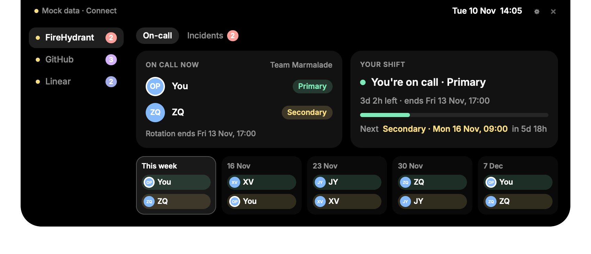
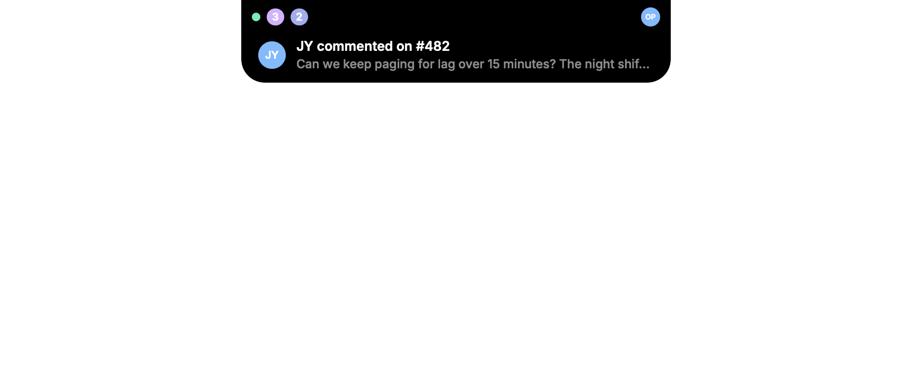
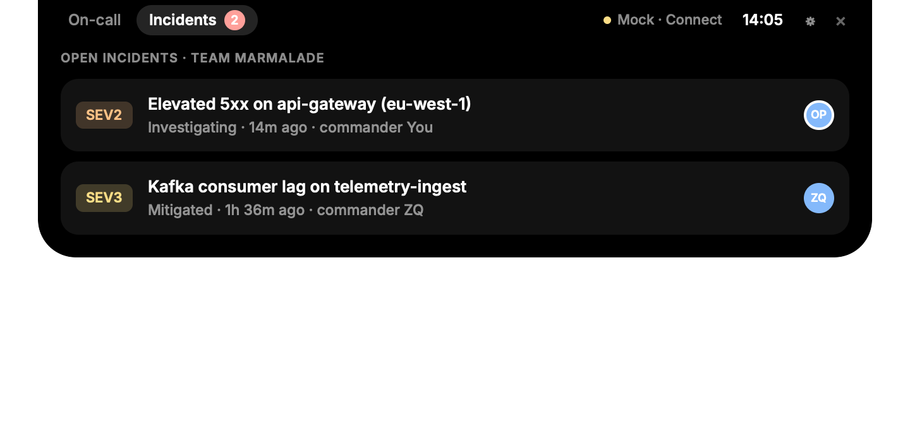
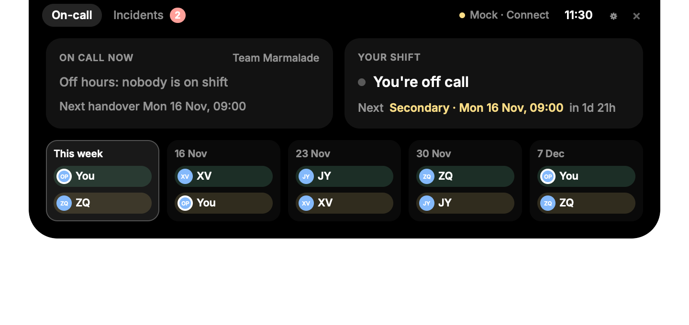
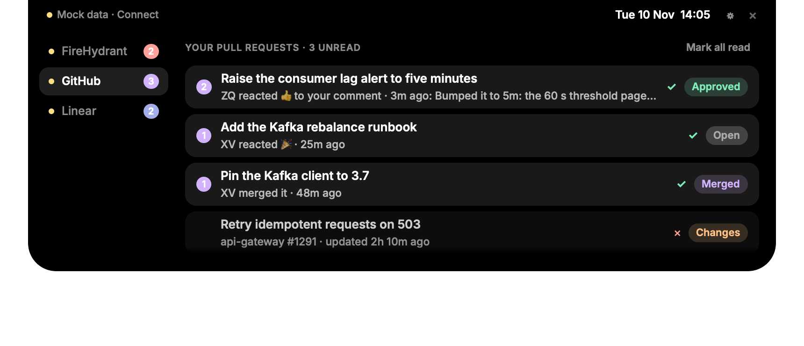
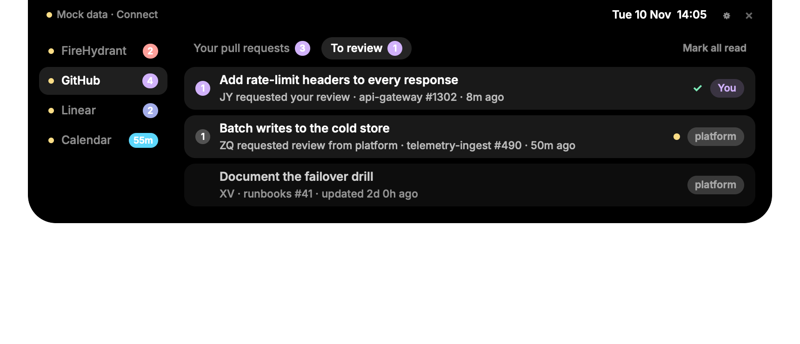
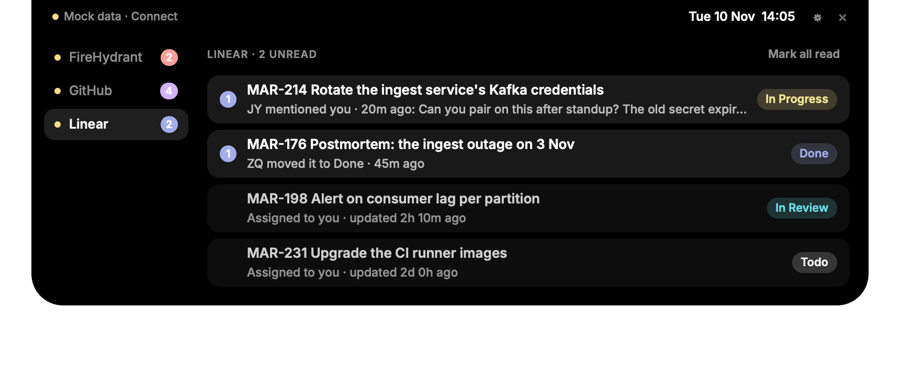
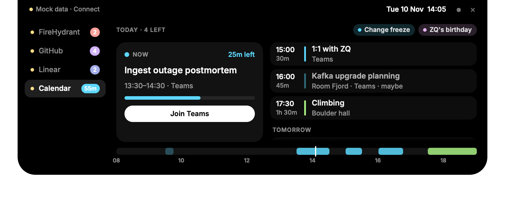
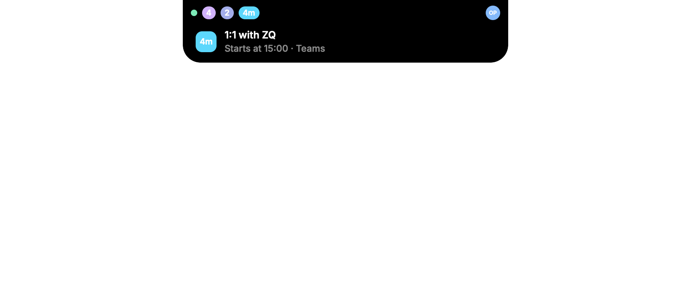

# Notch Assistant

A Dynamic-Island-style panel for the MacBook notch that shows your FireHydrant on-call rotation and
incidents, your GitHub pull requests and the ones you're asked to review, your Linear issues and notifications, and
your meetings from the Calendar app, built with [Rune](https://github.com/anomalyco/rune). Hover the notch and it springs open; move away and it closes
after a short grace period. On an external display it sits in the middle of the menu bar as a "virtual
notch".



**Demo video:** [demo/notch-assistant.mp4](demo/notch-assistant.mp4) (53 s: hover, each integration in the sidebar, the pull requests to review and the Calendar section, Settings, connecting and allowing calendar access).

| Collapsed | Something new | Incidents | Off hours |
| --- | --- | --- | --- |
|  |  |  |  |

| Your pull requests | To review | Linear |
| --- | --- | --- |
|  |  |  |

| Calendar | A meeting soon |
| --- | --- |
|  |  |

## What it shows

The open panel has a sidebar of integrations, each with its count; pick one and its data shows beside it.

- **FireHydrant**, with a switch between:
  - **On-call:** who is primary and secondary now, your current shift with time left, your next shift,
    and a five-week rotation strip like FireHydrant's month view.
  - **Incidents:** the team's open incidents with severity, status, age and commander.
- **GitHub**, with a switch between:
  - **Your pull requests:** unread first: who commented, reviewed, reacted to your comment or merged it
    since you last looked, with checks and review state. "Ready to merge" marks the ones GitHub would
    merge now.
  - **To review:** others' pull requests waiting for your review or a team's, new requests first.
- **Linear:** issues and projects with notifications you haven't read (mentions, comments, status
  changes, assignments, SLA breaches), then your open issues.
- **Calendar:** the meeting you're in or your next one, with a Join button for its call, the rest of today
  and tomorrow, and today on a timeline, from every calendar in the Calendar app.
- **Collapsed:** a dot left of the notch (green: you're primary, amber: secondary, grey: off call), a count
  beside it for each integration with something unread (purple: GitHub, indigo: Linear), a countdown to a
  meeting that starts soon, and the current primary's avatar on the right. When something new arrives or a
  meeting is about to start, the island drops a line under the notch for six seconds saying what; hovering
  it opens that integration. Several in a row take turns, meetings first, and they wait while an app is
  full screen on that display, so a slideshow or a full-screen call stays clean.

In GitHub and Linear, a click opens the item where the unread part starts and marks it read. Until an
integration is connected, it shows mock data, labelled "Mock data · Connect" in the panel.

## Install

With Homebrew (Apple silicon, macOS 13 or later):

```sh
brew install --cask shmileee/tap/notch-assistant      # add --appdir ~/Applications if /Applications needs admin
```

Or from source:

```sh
make install       # builds the app into ~/Applications, starts it, and opens it at login
make uninstall     # stops it and removes the app and the login item (settings and Keychain item stay)
```

`INSTALL_DIR=/Applications` installs it for every user; `LOGIN=0` skips open at login.

Then open the panel, click ⚙, and add your FireHydrant API key and team ID (see [FireHydrant](#firehydrant)),
a GitHub token and a Linear API key (see [GitHub and Linear](#github-and-linear)), and allow calendar access
(see [Calendar](#calendar)).

- **Quitting:** the × in the open panel, or ⌘Q while Settings is in front.
- **Screen sharing:** the panel is left out of screen sharing, recordings and screenshots, so a shared
  screen doesn't show what it peeks at. The **Show in screen sharing** switch in Settings puts it back.
- **Open at login:** a switch at the bottom left of Settings, also in System Settings › General › Login
  Items, or `"<app>/Contents/MacOS/notch-assistant" --login on|off|status`.
- **Upgrading and uninstalling:** the app restarts itself when a new version replaces it and quits when it's
  removed, so `brew upgrade` and `brew uninstall` need no extra step (Homebrew's own quit is skipped on Macs
  whose login comes from single sign-on).
- **Signing:** releases are signed with the project's own certificate, not Apple's, so macOS keeps the
  Calendar permission across upgrades. The app isn't notarized; the cask clears the quarantine flag on
  download. A build from source is ad-hoc signed, unless `CODESIGN_IDENTITY` names a certificate.

## FireHydrant

Settings has three fields; environment variables override them:

| Field | Stored in | Override |
| --- | --- | --- |
| API key | login Keychain, service `notch-assistant` (never shown again; paste a new one to replace it) | `FIREHYDRANT_API_TOKEN` |
| Team ID | `~/Library/Application Support/notch-assistant/settings.json` | `FIREHYDRANT_TEAM_ID` |
| Your name on the schedule | same file | `FIREHYDRANT_ME` |

Saving reconnects and tests the connection; the panel then refreshes every five minutes. `NOTCH_MOCK=1`
forces the mock.

An API key acts as a bot user, so "you" on the schedule is found by name: `FIREHYDRANT_ME` (a full name or
FireHydrant user ID), else this Mac account's full name. It makes three kinds of read-only call:

- `GET /v1/current_user`: the token's user, the fallback for "you".
- `GET /v1/teams/{team}/on_call_schedules`: the team's shifts from this Monday to five weeks out. A
  schedule whose name contains "secondary" is the secondary rotation. Shifts of the same person and role
  up to four days apart, with nobody else's shift in between, count as one rotation, so a weekend doesn't
  split it.
- `GET /v1/incidents?teams={team}`: the team's active incidents, up to five pages of them.

To check what it reads without launching the app: `cargo run --release -- --probe` (`--probe-raw` dumps
the JSON).

## GitHub and Linear

Each needs one secret in Settings: a classic GitHub token with the `repo` scope, and a Linear API key with
Read access. Both are read-only, and both count something as unread until you read it in the panel or on
the service. How to create them, what counts, and what each one calls:

- [docs/github.md](docs/github.md)
- [docs/linear.md](docs/linear.md)

## Calendar

Calendar needs no key: it reads every account in the Calendar app through macOS, once you click Allow
access in Settings › Calendar. What it shows and what to do when macOS asks again:
[docs/calendar.md](docs/calendar.md).

## Development

```sh
cargo run --release                                        # run it (quit the installed copy first; a second copy quits)
cargo test
cargo run -- --scene open --snap snaps/open.png           # scenes: collapsed, open, incidents, offhours, pulls, reviews, linear, calendar, peek, soon
cargo run -- --scene collapsed --script scripts/hover.json --snap mid.png --at 0.75
```

Scenes and demo mode use the mock with the clock pinned to Tue 10 Nov 2026, 14:05, so images are
reproducible. The mock is modelled on a real team's calendar: weekly rotations ZQ → OP → XV → JY, Monday
09:00 to Friday 17:00, where the secondary is last week's primary. `NOTCH_ME=ZQ` changes who "you" are in
it (default `OP`).

**Recording the demo video.** `scripts/record-demo.sh` writes `demo/notch-assistant.mp4`. It runs the app
in demo mode (`NOTCH_DEMO=1`: mock data, settings in memory, a simulated connection test, a backdrop over
the desktop) and records the MacBook display while `scripts/demo/driver.swift` drives the pointer and
keyboard. Keep hands off for about a minute. It needs Screen Recording and Accessibility permission for your
terminal, `ffmpeg` and the Xcode command-line tools. When you add a feature, add its steps to `tour` in
`driver.swift`, and update `Spot` when the layout moves. To check positions, run with `NOTCH_DEMO=1`
(plus `NOTCH_OPEN_SETTINGS=1` to open Settings at launch) and take a screenshot.

**Releasing.** Bump `version` in `Cargo.toml`, commit, then `git tag vX.Y.Z && git push --tags`.
`.github/workflows/release.yml` builds `NotchAssistant-<version>-arm64.zip` on an Apple-silicon runner and
attaches it to the GitHub release (`make dist` makes the same zip locally). It signs the app with the
certificate in the `MACOS_SIGNING_P12` and `MACOS_SIGNING_PASSWORD` secrets and won't release without
it. Renovate in the tap then proposes the cask update. `make icon` redraws `assets/AppIcon.icns`.

### How it works

| File | Role |
| --- | --- |
| `src/main.rs` | App setup: a transparent overlay at the top of the display under the pointer, where only the island takes clicks. Also the timers, the minute refresh and the snapshot scenes. |
| `src/notch.rs` | The notch of the current display (`NSScreen.safeAreaInsets`), or a virtual 185-pt one as tall as the menu bar. Also whether another app is full screen there. |
| `src/anchor.rs` | Keeps the panel at the top of its display: out of the Accessibility window list, so window managers such as Rectangle can't grab it, and put back on the next poll if anything moves it. |
| `src/island.rs` | The hover state machine: `Collapsed → Arming (120 ms) → Open → Closing (400 ms)`, so a passing pointer doesn't open it. |
| `src/view.rs` | The island, and the open panel's sidebar and sections. Beside a real notch, the top bar keeps clear of it. |
| `src/oncall.rs` | The `OnCallSource` trait, the mock, and the `Snapshot` the view renders. |
| `src/firehydrant.rs` | The FireHydrant client, its integration declaration and its refresh thread. |
| `src/pulls.rs` | Pull requests and their activity, and the mock. |
| `src/github.rs` | The GitHub client and its integration declaration. |
| `src/issues.rs` | Linear issues, projects and notifications, and the mock. |
| `src/linear.rs` | The Linear client and its integration declaration. |
| `src/agenda.rs` | Meetings, what the Calendar section picks from them at a given moment, join links, and the mock. |
| `src/calendar.rs` | The EventKit client, the calendar permission and its integration declaration. |
| `src/feed.rs` | A notifying integration's data, read state and refresh thread, which retries sooner after a failure. |
| `src/net.rs` | The HTTP agent: the Keychain's root certificates as well as ureq's, and the system's HTTPS proxy. |
| `src/wake.rs` | Refreshes everything when the Mac wakes from sleep. |
| `src/time.rs` | Times as instants shown in local time, so clock changes and time-zone travel don't shift them. |
| `src/read.rs` | What you've read of each, and which unread events are new since the last refresh. |
| `src/integrations.rs` | The integration registry: each one's fields (`Secret`, `Text` or a macOS `Permission`), env overrides and connection test. |
| `src/store.rs` | Secrets in the Keychain (written via `security -i`, never on a command line), the rest in settings.json, written whole or not at all. Also the lock that keeps a second copy from running. |
| `src/settings.rs` | The Settings window, built from the registry. |
| `src/login.rs` | Open at login (`SMAppService`); only the app bundle can register. |
| `src/installed.rs` | Restarts the app when its installed copy is replaced and quits it when removed. |
| `src/demo.rs` | Demo mode for recordings. |
| `scripts/bundle.sh`, `Makefile` | The app bundle (Info.plist with the calendar usage text, icon, signature), install, uninstall and release zip. |

**Adding an integration.** Declare an `Integration` (its fields, the one it can't run without, and a test) and add it to
`integrations::ALL`; it appears in Settings, and its values come from `integration.value(key)`. Fetch its
data on a worker thread: a `feed::Feed` does that, keeps read state and spots new events, as GitHub and
Linear use it. Give it a `Section` (its sidebar entry and view in `view.rs`) and add a mock so scenes and
demo mode keep working. Another kind of sign-in (OAuth, say) is a new `FieldKind` with its own control in
`settings.rs`, as the calendar's `Permission` has.

## License

[MIT](LICENSE)
