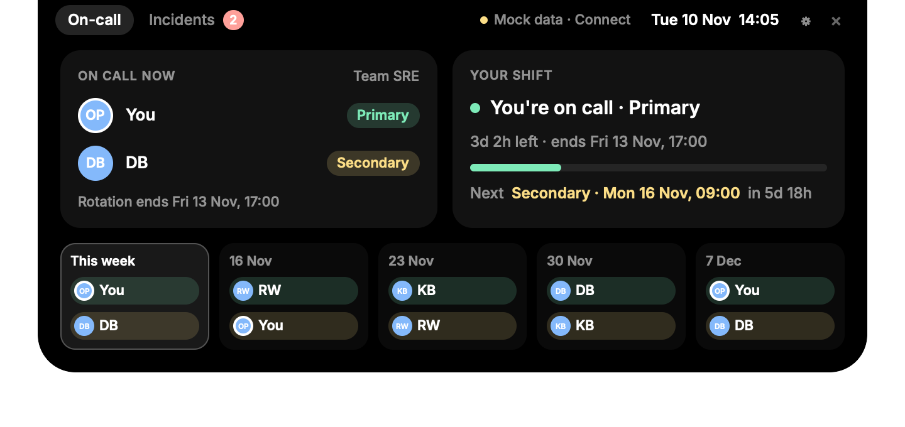
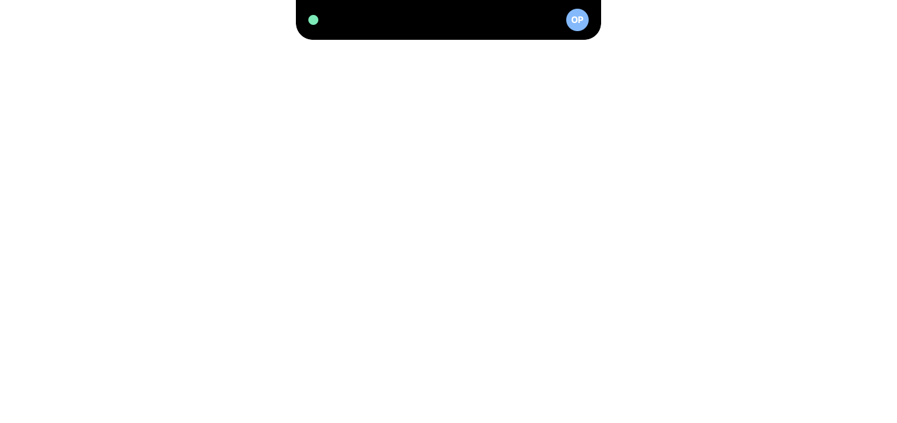
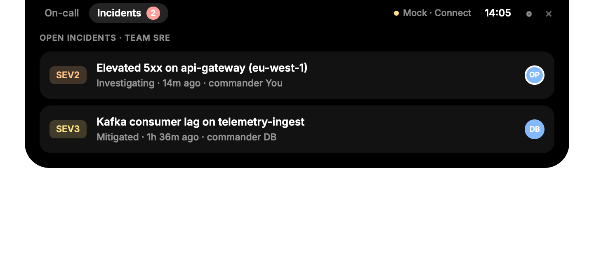
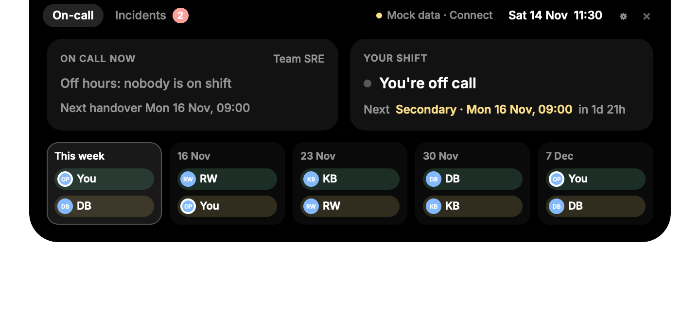

# Notch assistant

A Dynamic-Island-style panel for the MacBook notch, built with [Rune](https://github.com/anomalyco/rune).
Hover the notch and it springs open. Move the pointer away and it closes after a short grace period.
It follows the pointer between displays: on the MacBook it wraps the real notch, and on an external
monitor it sits in the middle of the menu bar as a "virtual notch" as tall as the menu bar.



**Demo video:** [demo/notch-assistant.mp4](demo/notch-assistant.mp4) (32 s: hover, tabs, Settings, connecting).

| Collapsed | Incidents | Off hours |
| --- | --- | --- |
|  |  |  |

## Run

```sh
cargo run --release
```

It runs as an accessory app, so it has no Dock icon and no menu. To quit, click the × in the open panel, press ⌘Q while Settings is in front, or run `pkill notch-assistant`.
`NOTCH_ME=DB` changes who "you" are in the rotation (the default is `OP`).

## What it shows (mock data for now)

- **On-call**: who is primary and secondary right now, your own shift with time left and a progress bar,
  your next shift, and a five-week rotation strip, like the FireHydrant month view.
- **Incidents**: open incidents for the team, with severity, status, age and commander.
- **Collapsed**: a dot on the left of the notch (green: you're primary, amber: secondary, grey: off call)
  and the current primary's avatar on the right.

The mock copies Team SRE EMEA's November 2026 calendar: weekly rotations DB → OP → RW → KB, where the
secondary is the previous week's primary. Shifts are assumed to run Mon 09:00 to Fri 17:00.

## How it works

| File | Role |
| --- | --- |
| `src/main.rs` | App setup. A transparent overlay at the top edge of the display under the pointer (`DisplayTarget::UnderPointer` + `follow_pointer`), above the menu bar. Only the island itself takes the pointer (`OverlayInput::Regions`); everything else passes clicks through. Also `poll` (timers, a refresh each minute) and the snapshot scenes. |
| `src/notch.rs` | The notch of the display under the pointer: `NSScreen.safeAreaInsets` / `auxiliaryTop{Left,Right}Area` where there is one, else a virtual 185-pt notch as tall as that display's menu bar. `poll` re-checks it each second, so the island reshapes when it moves to another display. |
| `src/island.rs` | The hover state machine: `Collapsed → Arming (120 ms) → Open → Closing (400 ms)`. A pointer that only sweeps past doesn't open it, and slipping off the edge briefly doesn't close it. A click opens it at once. Unit tested. |
| `src/oncall.rs` | The `OnCallSource` trait, `MockSource`, and the `Snapshot` the view renders. Unit tested against the calendar screenshot. |
| `src/view.rs` | The island and its tabs. |
| `src/integrations.rs` | The integration registry: each one declares its fields (`Secret` or `Text`), the env vars that override them, and a connection test. |
| `src/store.rs` | Secrets in the Keychain (written via `security -i`, so a secret never appears on a command line), the rest in settings.json. |
| `src/settings.rs` | The Settings window, built from the registry. |
| `src/firehydrant.rs` | The FireHydrant client, its `INTEGRATION` declaration, and the five-minute refresh thread. |
| `src/demo.rs` | Demo mode for recordings: pinned clock, in-memory settings, the backdrop, the Settings window's place. |

### Adding an integration

1. Declare an `Integration` (id, name, fields, required secret, test) and add it to `integrations::ALL`.
   It appears in Settings with its fields, and its values come from `integration.value(key)`.
2. Fetch its data on a worker thread, as `firehydrant::spawn` does, and give it a tab or card in the panel.
3. Another kind of auth (an OAuth sign-in, say) is a new `FieldKind` with its own control in
   `settings.rs`, a "Connect" button for instance, which stores the tokens it gets with `store::set_secret`.

## Recording a demo video

```sh
scripts/record-demo.sh                 # → demo/notch-assistant.mp4
```

It runs the real app in demo mode on the MacBook's display and records it with `screencapture`, while
`scripts/demo/driver.swift` moves the pointer, clicks and types. Keep hands off the mouse and keyboard
for the ~35 s it runs. Your terminal needs Screen Recording and Accessibility permission, plus `ffmpeg`
and the Xcode command-line tools. A running copy of the app is stopped first and relaunched afterwards.

Demo mode (`NOTCH_DEMO=1`, see `src/demo.rs`) makes every recording the same and keeps it private:
mock data with the clock pinned to Tue 10 Nov 2026 14:05, settings kept in memory (your Keychain is
untouched), a simulated connection test, and a backdrop that covers the desktop and menu bar.

**When you add a feature,** add its steps to `tour` in `driver.swift`. Positions are in points from the
display's top-left, taken from the layout in `src/view.rs` and `src/settings.rs`; update `Spot` when the
layout moves. To check positions without recording, run the app with `NOTCH_DEMO=1` (add
`NOTCH_OPEN_SETTINGS=1` to open Settings at launch) and take a screenshot.

## Checking it headlessly

```sh
cargo test
cargo run -- --scene open --snap snaps/open.png          # scenes: collapsed, open, incidents, offhours
cargo run -- --scene collapsed --script scripts/hover.json --snap mid.png --at 0.75
```

Scenes pin the clock to Tue 10 Nov 2026, 14:05 so the images are reproducible.

## FireHydrant

With a token, the panel shows live data, refreshed every five minutes. Without one it shows the mock,
labelled "Mock data" in the panel. `src/firehydrant.rs` makes three read-only calls:

- `GET /v1/current_user`: the token's user. An API key acts as a bot user (e.g. "opo (bot)"), so
  "you" on the schedule is found by name: `FIREHYDRANT_ME` (a full name or FireHydrant user ID), else
  this Mac account's full name (`id -F`). The bot user is only the fallback.
- `GET /v1/teams/{team}/on_call_schedules?shift_time_window_start=…&shift_time_window_end=…`: the
  team's schedules with their shifts from this Monday to five weeks out. A schedule whose name contains
  "secondary" counts as the secondary rotation. Shifts are daily (09:00–16:00), so back-to-back days for
  the same person and role count as one rotation: "next shift" skips the rest of your current one.
- `GET /v1/incidents?teams={team}`: the team's active incidents.

**Connecting.** Open Settings with the ⚙ in the panel (or click "Mock data · Connect"), paste the API key,
and press Save. Saving reconnects the panel and tests the connection. The key goes in your login Keychain
(service `notch-assistant`, account `firehydrant.api_key`) and is never shown again; paste a new one to
replace it, or press Remove key. The team ID and your name go in
`~/Library/Application Support/notch-assistant/settings.json`.

Environment variables override Settings: `FIREHYDRANT_API_TOKEN`, `FIREHYDRANT_TEAM_ID`, `FIREHYDRANT_ME`.
`NOTCH_MOCK=1` forces the mock. A key stored earlier under the Keychain service `firehydrant-api-token`
still works.

**Check it** before launching: `cargo run --release -- --probe` prints the shifts, who is on now and
your incidents, as the app reads them. `--probe-raw` dumps the raw JSON.
